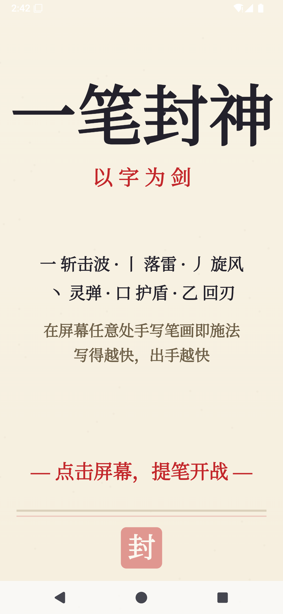
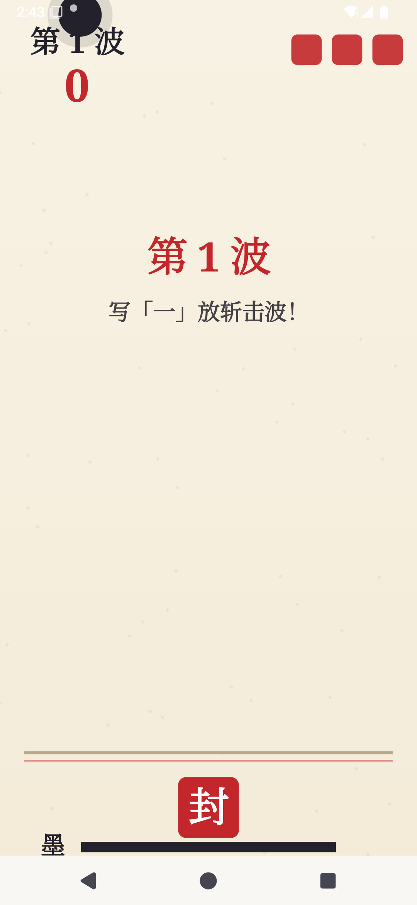
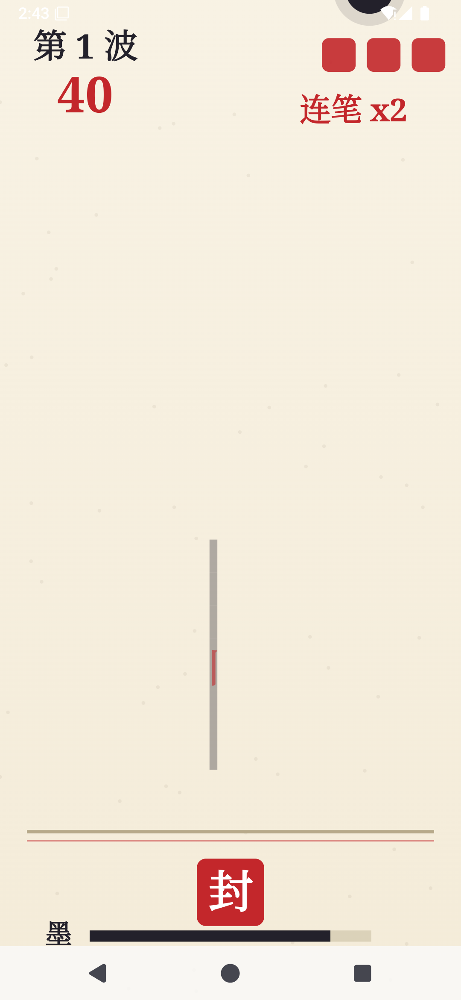

# 一笔封神 · 以字为剑

一款把中文手写笔画变成即时法术的 Android 生存动作游戏：在敌人抵达封印前，写出笔画施法、守住防线。

## 游戏玩法

敌人从屏幕上方逼近底部封印；触碰封印会损失朱印生命。玩家可在屏幕上划写笔画，抬手后触发对应法术。施法消耗会随时间恢复的墨量，因此需要在不同招式之间取舍。连续施法累积连笔倍率，波次逐渐推进，每逢第 5 波出现首领。

| 手写笔画 | 法术 | 效果 |
| --- | --- | --- |
| 一 | 斩击波 | 横向墨浪攻击敌人 |
| 丨 | 落雷 | 攻击敌群密集区域 |
| 丿 | 旋风 | 推开并减缓敌人 |
| 丶 | 灵弹 | 发射追踪墨弹 |
| 口 | 护盾 | 生成可抵挡攻击的护罩 |
| 乙 | 回刃 | 发射可弹射的刃 |

## 画面与交互

- 竖屏游玩，在触屏上直接书写笔画；界面显示波次、分数、连笔、墨量和封印状态。
- 以宣纸、墨色和朱红构成的简洁国风视觉；游戏画面由 Jetpack Compose Canvas 绘制。
- 项目内附有标题页、波次提示和实际对局截图，可用于快速了解游戏画面。

| 标题页 | 波次提示 |
| --- | --- |
|  |  |

| 笔画与对局画面 | 另一局内画面 |
| --- | --- |
|  |  |

## 技术栈

- Kotlin、Android Gradle Plugin 与 Jetpack Compose；游戏以自定义 Canvas 画面呈现。
- 笔画识别基于轨迹长度、净位移、直线度和包围盒等几何特征进行分类。
- 音效通过 Android `AudioTrack` 播放由代码合成的波形；仓库未附独立音频文件。
- Android `minSdk` 为 23，`targetSdk` 为 35；JVM 目标为 Java 17。

## 构建

仓库包含 Gradle Kotlin DSL 构建配置，但未包含 Gradle Wrapper。请准备已安装的 Gradle、Android SDK 及所需构建工具，然后在项目根目录运行：

```bash
gradle assembleDebug
```

成功构建后，Debug APK 预期位于 `app/build/outputs/apk/debug/app-debug.apk`。本仓库目前未附 APK 或发布页链接；构建结果以本机环境实际输出为准。
