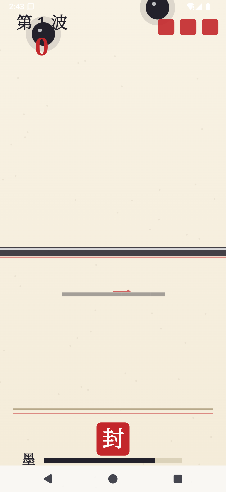

# 一笔封神 · 以字为剑

> **手写中文笔画 = 释放法术** 的原创动作游戏。敌人压境，你在屏幕上写什么就放什么：写「一」全屏斩击波，写「丨」召落雷，写「口」开护盾，写「丿」旋风推敌，写「丶」三连灵弹，写「乙」回旋刃。**写得越快，出手越快——练字即练级。**



## 玩法

- 敌人从上方压向底部的「封」印，触碰即扣朱印生命（共 3 枚）
- 全屏任意处手写笔画施法，抬手即出招（约 80ms 判定）
- **墨量**是资源：每个法术耗墨不同，随时间回复——快笔弱、大字强，写哪个是实时决策
- 连续施法累积**连笔倍率**（最高 x8），波次无限递增，每 5 波狂草兽 BOSS
- 一波平定 +25×波数，敌分 10×倍率，BOSS 四倍

## 法术表

| 笔画 | 法术 | 效果 | 耗墨 |
|---|---|---|---|
| 一 | 斩击波 | 全屏横向墨浪上扫，波及全伤 | 25 |
| 丨 | 落雷 | 劈向敌群最密集柱，范围 3 伤 | 22 |
| 丿 | 旋风 | 全场敌人上推 + 减速 2.2s | 15 |
| 丶 | 灵弹 | 三发追踪墨弹 | 8 |
| 口 | 护盾 | 底部护罩挡 3 次，持续 9s | 30 |
| 乙 | 回刃 | 之字弹射刃，可伤 3 次 | 18 |

## 实现

- **识别器**：轨迹度量法——总长/净位移/直线度/包围盒判定六种笔画，抗手抖，无 OCR 依赖（约 40 行核心）
- **画面**：宣纸 + 墨滴 + 朱砂国风，全部 Compose Canvas 程序化绘制；毛笔墨迹、三色斩浪、折线落雷均为实时绘制
- **音效**：AudioTrack 静态缓冲波形合成 12 条音轨（毛笔沙沙、雷爆、风啸、鼓点……），零音频文件
- 单文件引擎 `MainActivity.kt`（约 900 行），逻辑更新与渲染分离，实体删除全部走快照模式

## 构建

```bash
gradle assembleDebug   # 产物 app/build/outputs/apk/debug/app-debug.apk
```

Release 页可直接下载 APK（Android 6.0+）。
